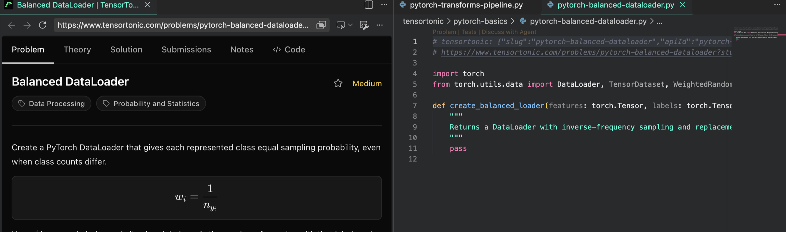
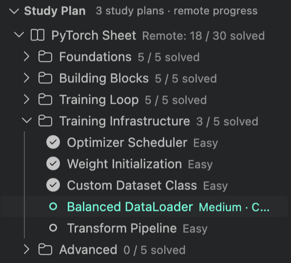
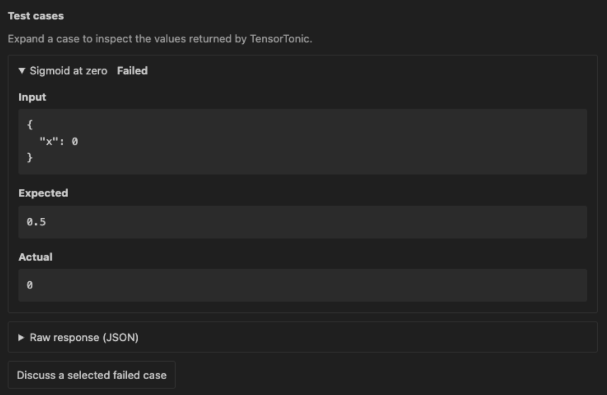
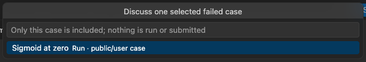
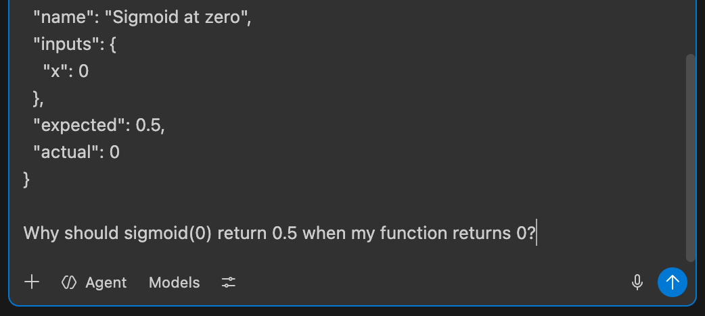
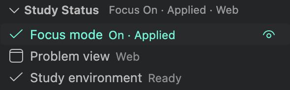

# TensorTonic for VS Code (Unofficial)

Solve TensorTonic machine learning problems in the editor where you write Python. Read an interactive explanation beside your `.py` file, try a test case, and submit the same solution to TensorTonic. When you come back, pick up your study plan where you left off.

*In this PyTorch exercise, the sampling formula stays in view while you implement the data loader. The website’s Theory, Solution, Submissions, and Notes tabs are one click away.*

[Download the 0.12.17 VSIX](releases/tensortonic-vscode-0.12.17.vsix?raw=true) · [Open your first problem](#open-your-first-problem)

## From a study plan to a submission

Keep multiple plans in the sidebar and resume the last problem you opened in each one. In the **PyTorch Sheet** below, 18 of 30 problems are solved. Expand **Training Infrastructure** to see the three completed exercises and open **Balanced DataLoader**. You can also choose **Next unsolved problem** or search by title. Reopening a problem preserves your solution and custom test cases.

Keep the interactive diagrams in **Web** view or switch to **Markdown** for a local description with equations. If you’ve added notes to that file, the extension asks you to save them before refreshing it. For the 30 PyTorch basics problems, **Offline learning exploration** offers hands-on examples. In Balanced DataLoader, change the class labels and draw count to see how weighted sampling behaves.

### From a failed test to an Agent question

1. Click **Tests** above your code to inspect public examples or edit your own cases. Choose **Run**, then expand a failed case in **Results**. In the local example below, the sigmoid of zero should be `0.5`, but the sample implementation returned `0`.

   

2. Click **Discuss a selected failed case** and pick **Sigmoid at zero**. You can choose which failed public example or custom case to share.

   

3. VS Code Chat opens an Agent draft with the selected case’s input, expected value, and actual value. Add your own question and choose **Send** when you’re ready. Here the learner asks why `sigmoid(0)` should return `0.5`.

   

After editing your code, check whether **Results** still matches your file. Choose **Run** to try the fix or **Submit** to get a grading verdict.

For a broader question, **Discuss with Agent** opens a draft with the problem and your code. In a chat that supports VS Code tools, **Read current TensorTonic problem** includes your unsaved Python edits. With the Codex extension installed, you can also attach the problem and solution to a thread.

## Keep the problem and code in view

Choose **Focus mode / Original view** to hide the website header and floating Ask Toni button. The problem tabs move up into the freed space. The sidebar shows **On · Applied** when Focus is active on that page. You can also show exercise difficulty as text or color in the sidebar, or hide it while you practice.

For local Python work on macOS or Linux, install Microsoft’s **Python** extension and choose **Create study environment**. TensorTonic sets up PyTorch and NumPy and reuses the environment when you reopen the folder. With Microsoft’s **Python Environments** extension enabled, the selected interpreter appears as **TensorTonic** in the status bar.

On a Mac with Homebrew, choose **Set up (install Python if needed)** to let setup install Python 3.13 if it can’t find a compatible version. If a system Python update later breaks the environment, **Repair study environment** preserves the old environment and sets up a replacement for the same study folder. [Python setup and repair](docs/study-python.md)

## Open your first problem

1. **Install the extension.** In desktop VS Code 1.144.0 or later, open the Command Palette, run **Extensions: Install from VSIX...**, and select the downloaded file. New sign-in and the interactive Web view require a local VS Code build that supports the proposed browser API.
2. **Enable the browser integration.** Follow the one-time setup instructions, then fully restart VS Code so it can open the sign-in and problem pages. [Browser setup guide](docs/native-browser.md#exact-opt-in)
3. **Connect your account.** In a trusted local window, run **TensorTonic: Start studying** and choose a folder. Run **TensorTonic: Connect session**, review the access prompt, and sign in on the page it opens. Once you’re back on TensorTonic, click **Capture session** in the VS Code status bar to finish connecting.

   

4. **Start solving.** Choose a plan and open a problem from the TensorTonic sidebar. Write in the Python file on the right and use **Run** when you’re ready to try your first case.

This unofficial extension supports Python problems in TensorTonic’s free catalogue and supported study plans. VS Code stores the captured session in encrypted secret storage. While that session is valid, you can close the website tab and still open problems in Markdown view, run tests, and submit online. Use **TensorTonic: Clear saved session** to remove it from the extension. [Session access and storage](docs/session-acquisition.md)

[Study plans, results, and Focus](docs/sidebar-and-results.md) · [Release notes](CHANGELOG.md) · [Download checksums](releases/SHA256SUMS.txt) · [Contributing](CONTRIBUTING.md)

TensorTonic’s website content and trademarks belong to their owners. The repository’s MIT license covers the extension code. [Icon provenance and licensing](docs/icon-provenance.md)
