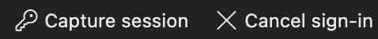

# TensorTonic for VS Code (Unofficial)

Solve TensorTonic machine learning problems in the editor where you write Python. Read an interactive explanation beside your `.py` file, try a test case, and submit the same solution to TensorTonic. When you come back, pick up your study plan where you left off.


*In this PyTorch exercise, the sampling formula stays in view while you implement the data loader. The website’s Theory, Solution, Submissions, and Notes tabs are one click away.*

[Download the 0.12.17 VSIX](https://raw.githubusercontent.com/choru-k/tensortonic-vscode/main/releases/tensortonic-vscode-0.12.17.vsix) · [Open your first problem](#open-your-first-problem)

## From a study plan to a submission

- **Pick up yesterday’s work.** Keep multiple plans in the sidebar, see which problems you’ve solved, and resume the last one you opened. Use **Next unsolved problem** to move ahead, or search by title when you know what you want to practice.
- **Read and experiment.** Keep the interactive diagrams in **Web** view or switch to **Markdown** for a local description with equations. For the 30 PyTorch basics problems, **Offline learning exploration** also offers hands-on examples. In Balanced DataLoader, change the class labels and draw count to see how weighted sampling behaves.
- **Try a case, then submit.** Click **Tests** above your code to inspect public examples or edit your own cases. **Run** checks them on TensorTonic. Expand a case in **Results** to see what happened and whether you’ve edited the inputs since. Choose **Submit** when you want a grading verdict.
- **Talk through a failure.** **Discuss with Agent** opens a chat draft with the problem and your code. For a narrower question, choose **Discuss a selected failed case** in Results and review the public or custom case before sending. With the Codex extension installed, you can also attach the problem and solution to a thread.

## Keep the problem and code in view

Choose **Focus mode / Original view** to hide the website header and floating Ask Toni button. The problem tabs move up into the freed space. The sidebar shows **On · Applied** when Focus is active on that page.


For local Python work on macOS or Linux, install Microsoft’s **Python** extension and choose **Create study environment**. TensorTonic sets up PyTorch and NumPy in a dedicated environment and reuses it when you reopen the folder. With Microsoft’s **Python Environments** extension enabled, the selected interpreter appears as **TensorTonic** in the status bar. If a system Python update breaks the environment, choose **Repair study environment** in the sidebar. [Python setup and repair](docs/study-python.md)

## Open your first problem

1. **Install the extension.** In desktop VS Code 1.144.0 or later, open the Command Palette, run **Extensions: Install from VSIX...**, and select the downloaded file. New sign-in and the interactive Web view require a local VS Code build that supports the proposed browser API.
2. **Enable the browser integration.** Save your work and fully quit VS Code, then launch it with the command below. Replace the example path with your study folder. You can also set this once in VS Code’s runtime arguments. [Persistent browser setup](docs/native-browser.md#exact-opt-in)

   ```sh
   code --enable-proposed-api choru-local.tensortonic-vscode "/path/to/Study"
   ```

3. **Connect your account.** In a trusted local window, run **TensorTonic: Start studying** and choose a folder. Run **TensorTonic: Connect session**, review the access prompt, and sign in on the page it opens. Once you’re back on TensorTonic, click **Capture session** in the VS Code status bar to finish connecting.

   

4. **Start solving.** Choose a plan and open a problem from the TensorTonic sidebar. Write in the Python file on the right and use **Run** when you’re ready to try your first case.

This unofficial extension supports Python problems in TensorTonic’s free catalogue and supported study plans. Your TensorTonic account determines which problems you can access. VS Code stores the captured session in encrypted secret storage. Use **TensorTonic: Clear saved session** to remove it from the extension. [Session access and storage](docs/session-acquisition.md)

[Study plans, results, and Focus](docs/sidebar-and-results.md) · [Release notes](CHANGELOG.md) · [Download checksums](releases/SHA256SUMS.txt) · [Contributing](CONTRIBUTING.md)

TensorTonic’s website content and trademarks belong to their owners. The repository’s MIT license covers the extension code. [Icon provenance and licensing](docs/icon-provenance.md)
